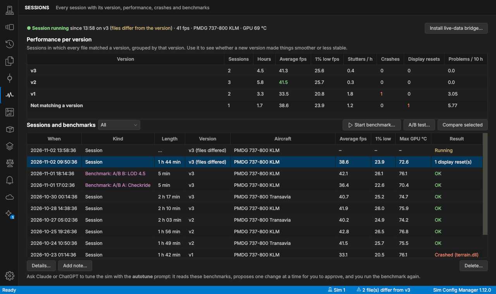
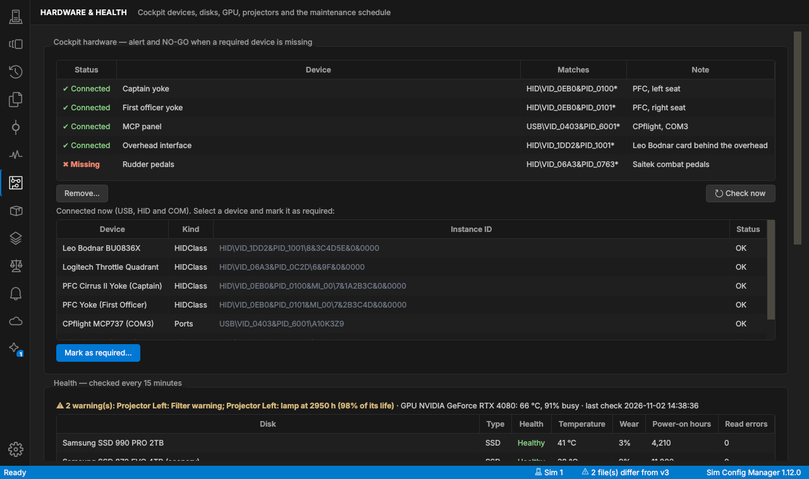
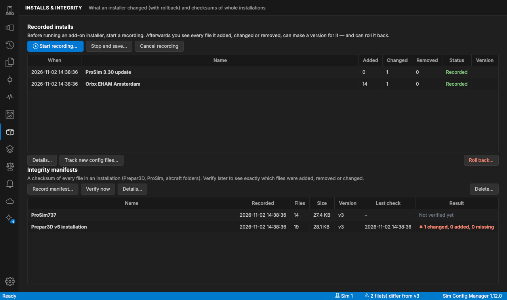
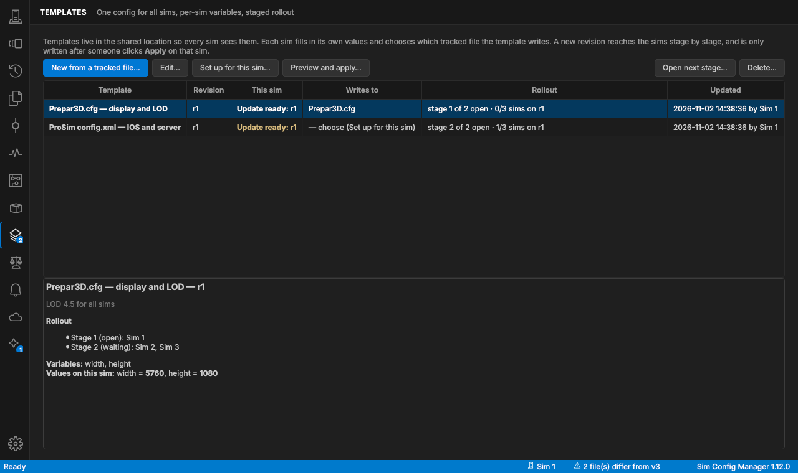
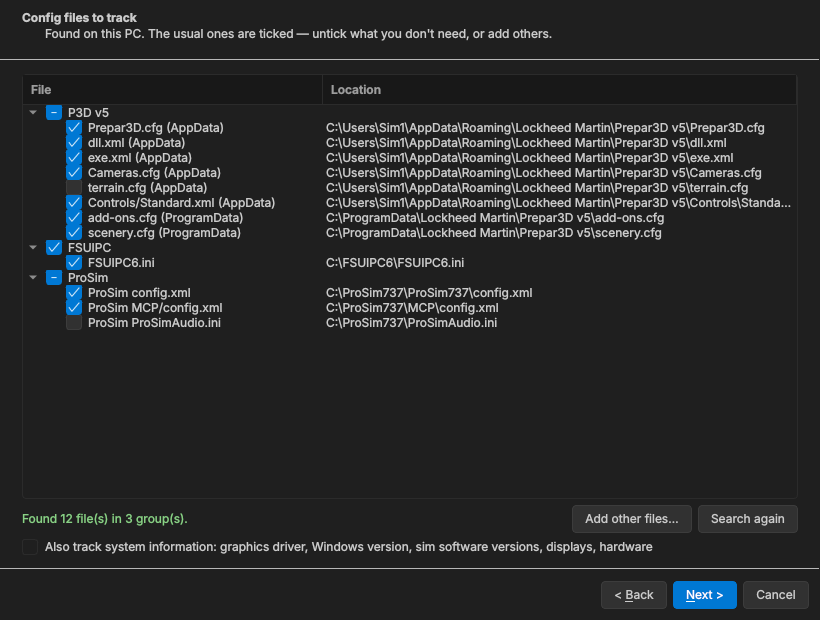
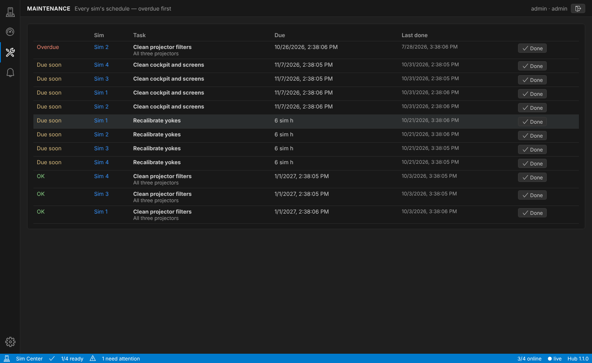
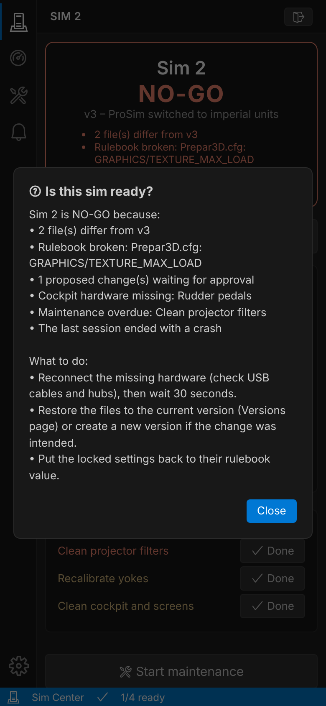
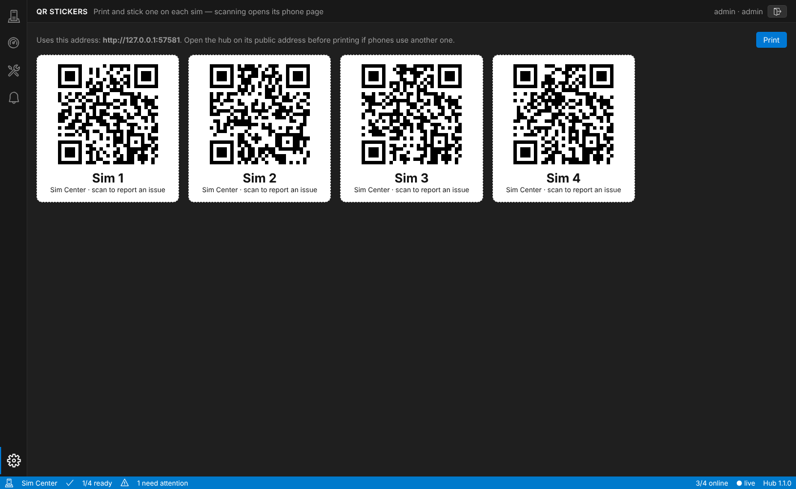

# Sim Config Manager

Keeps track of Prepar3D / ProSim (or any) config files on your sims, like git: every change is
recorded, you can see exactly what changed, and you can put everything back with one button.

> [!WARNING]
> **This project was made entirely by AI** (Anthropic's Claude). The repository owner did not write or review
> the code. It is provided **as is, without any warranty or support**. Test it on a non-critical machine and keep
> your own backups before relying on it. See the [Disclaimer](#disclaimer) below.


## Features

- ⭐ **Git-style history** for config files anywhere on disk — every change recorded automatically, line-by-line and per-setting diffs
- ⭐ **One-click restore** — named restore points ("Customer default", "Checkride"), restore everything or one group; always undoable
- ⭐ **Numbered versions** (v1, v2 …) of the whole configuration + overview of which files differ
- ⭐ **Certification archives** — one zip with all files, report and SHA-256 checksums; import on any PC
- ⭐ **Claude & ChatGPT** can read configs, history and other sims to troubleshoot; proposed changes need your approval
- ⭐ **Remote app** — work on any sim from another PC or a Mac over the LAN
- ⭐ **Fleet overview** of all sims, shared through **Google Drive** (direct) or any shared folder
- ⭐ **Hub web dashboard** (optional, self-hosted Node.js) — live status of every sim in a browser or on a wall
  screen: GO / NO-GO board, events, logbook, maintenance, uptime, Slack/Teams/Discord/ntfy alerts
- ⭐ **Sessions & performance** — every session logged with the version it ran on, frame rate, GPU temperature,
  crashes (with the faulting module) and display driver resets; performance compared per version
- ⭐ **Benchmarks & A/B tests**, and an **autotune** loop where Claude proposes one change at a time for you to approve
- ⭐ **Cockpit hardware watchdog** — required yokes, panels and interface boards; missing = alert and NO-GO
- ⭐ **Record an install** — see every file an add-on installer added or changed, make a version, roll it back
- **Who changed it** — which program and Windows user wrote each change (Windows file auditing)
- **Integrity manifests** — checksums of whole installations (Prepar3D, ProSim, aircraft) to spot any change
- **Shared templates** — one config for all sims with per-sim variables and a staged rollout
- **Health & maintenance** — disk health, GPU temperature, projector lamp hours (PJLink), maintenance schedule
  by date or sim hours
- **Configuration manual** generated from the records (PDF, Markdown for Notion, HTML)
- **Phone page behind a QR sticker** on each sim — log an issue with a photo, mark maintenance done, ask why it's NO-GO
- **Built-in editor** with syntax highlighting, live syntax check, find/replace; keeps encoding and line endings
- **Rulebook** — document settings and lock required values
- **Alerts** with notifications and optional auto-undo; **ignore** values the sim rewrites itself
- **System information** tracked like files — GPU driver, Windows build, sim software versions, displays, hardware
- Compare and copy configs between sims · rebuild a reinstalled PC from the backup · changelog export (Notion / Sheets)
- Finds Prepar3D and ProSim config files automatically
- VS Code–style interface (dark, light or follow the system) — the same on Windows and Mac
- Tray app, starts with Windows (as administrator), installer + in-app updates


## Screenshots

| | |
|---|---|
| **Restore points** — one button per saved setup  | **Files** — every tracked file with its revisions and who changed them  |
| **Sessions** — performance per version, crashes, benchmarks  | **Hardware & health** — required devices, disks, projectors, maintenance  |
| **Installs & integrity** — what an installer changed, with rollback  | **Templates** — one config for all sims, staged rollout  |
| **Editor** — syntax highlighting, find & replace  | **Live syntax check** — broken XML marked before you save  |
| **Alerts** — notifications and auto-undo for specific changes  | **Create version** — release notes pre-filled with what changed  |
| **Fleet** — every sim at a glance, via Google Drive or a shared folder  | **Rulebook** — documented and locked settings with live compliance  |
| **Setting-level changes** — and one click to ignore values the sim rewrites itself  | **Sharing** — Google Drive direct (no Drive app needed) or a shared folder  |
| **Differences** — exactly what changed, line by line  | **Claude** — reads your configs, proposes changes you approve  |

## Download

Get **SimConfigManager-Setup-x.y.z.exe** from the [latest release](../../releases/latest) and run it on each
sim (and on Windows laptops that should work on the sims remotely; Macs use `SimConfigManager-mac.zip`). It installs both programs (the app and the Claude/ChatGPT connector) in *Program Files*, adds a Start-menu
entry, and can be uninstalled normally (your data in `C:\ProgramData\SimConfigManager` is kept). The loose
`.exe` files are in the release too, if you prefer copying them by hand.

**Updates:** *Settings → Check for updates* (or the daily check) downloads the newest installer, verifies it
against `SHA256SUMS.txt`, installs it silently and restarts the app.
Every push to `main` is also built automatically: *Actions* tab → latest run → *Artifacts*.

To publish a new release, raise `APP_VERSION` in `simconfigmanager/core/util.py` and push to `main` — the build
publishes `v<version>` automatically (existing releases are never overwritten).

## Install (on each sim PC)

1. Download `SimConfigManager.exe` (or build it yourself: install Python 3.10+ from python.org, tick
   "Add python.exe to PATH", then double-click **build_exe.bat** → `dist\SimConfigManager.exe`).
2. Copy the exe to e.g. `C:\SimConfigManager\` on each sim and run it.
3. Windows asks for administrator rights when it starts (needed to restore files under Program Files /
   ProgramData) — click **Yes**.
4. *Settings → This sim*: give the PC a name (`Sim 1`, `Sim 2`) and tick **Start with Windows as administrator**.
   This creates a Task Scheduler task ("SimConfigManager", run with highest privileges at logon), so it starts
   elevated at boot **without** a UAC prompt. (The normal Startup/Run method cannot start admin programs.)

(The exe can be built once and copied to both sims. `run_from_source.bat` runs it without building.)

## First-time setup

The first time the app opens on a sim, a short setup guides you through it (run it again any time from
*Settings → Run first-time setup again…*):

1. **Name** this sim (`Sim 1`, `Sim 2` …) and yourself.
2. **Config files** — Prepar3D, FSUIPC and ProSim files are found automatically; the usual ones (Prepar3D.cfg,
   dll.xml, exe.xml, add-ons.cfg, Cameras.cfg, scenery.cfg, Controls, FSUIPC ini, ProSim config.xml and the ProSim
   System's cockpitsetup.xml) are ticked.
   Untick what you don't need or add other files. Optionally also track system information.
3. **Shared location** — a shared folder (or Google Drive, finished on the Sharing page afterwards).
4. **Hub** — the address of your dashboard and this sim's key, with a connection test. Leave empty if you don't
   use one.
5. **Options** — start with Windows, quiet while flying, "who changed it", the live-data bridge.
6. **Finish** — optionally creates **v1** right away as the starting point.



Afterwards, save the setups you switch between as restore points (**Restore points → Save current setup as
restore point…**). Everything from the setup can be changed later on its own page.

## What it does

| Feature | Where |
|---|---|
| Watches tracked files (every 5 s by default) and records a snapshot whenever one changes | automatic |
| **Versions**: number the whole configuration (v1, v2, …) and see at a glance what differs | Versions |
| **Restore points**: one-click "restore everything" buttons, or only one group | Restore points, tray menu |
| Full history per file (revisions), coloured line-by-line and per-setting diffs, restore one revision | Files |
| Every snapshot; restore everything to any moment; safety copy before every restore, so it can be undone | History |
| **Built-in editor** with syntax highlighting (CFG/INI, XML, JSON) | Files → Open in editor (or double-click) |
| **Who changed it**: program and Windows user per change | Files (revisions), Settings → This sim |
| **Sessions**: version, files matched, aircraft, frame rate, GPU temperature, crashes and display resets | Sessions |
| **Performance per version**, **benchmarks**, **A/B tests**, AI **autotune** | Sessions |
| **Cockpit hardware watchdog**: required devices, alert + NO-GO when one is missing | Hardware & health |
| **Health**: disk health and wear, GPU temperature, projector status and lamp hours (PJLink) | Hardware & health |
| **Maintenance schedule** by date or sim hours, mark done in the app or on the Hub (phone) | Hardware & health, Hub |
| **Record an install** (change package, version, rollback) and **integrity manifests** | Installs & integrity |
| **Templates**: one config for all sims with per-sim variables and a staged rollout | Templates |
| **Rulebook**: notes per setting, *required values* lock settings (alerts, editor warning, AI won't change them) | Rulebook |
| Alert rules with notifications and optional **auto-undo**; **ignored settings** | Alerts, any diff window |
| **System information** tracked like files: GPU & driver, Windows build, sim software, displays, hardware, own commands | Files → Add → System information |
| Warns if Prepar3D / ProSim are running before a restore (P3D rewrites Prepar3D.cfg on exit) | automatic |
| **Shared location**: Google Drive (direct) or any shared folder — off-site history backup and fleet | Sharing |
| See another sim's files, compare them, copy a file across; rebuild a reinstalled PC from the backup | Sharing |
| **Fleet overview**: every sim's version match, rulebook, hardware & health, last session, alerts | Fleet |
| **Hub** (optional web dashboard) | Sharing → Hub |
| **Certification archive** (zip + REPORT.txt + checksums), import on any PC, changelog, **configuration manual** | History → Export |
| **Claude / ChatGPT**: read configs, history, sessions and other sims; propose changes you approve | AI & network |
| Claude from mechanics' MacBooks, ChatGPT through an engineer's Mac, each with a personal access key | AI & network → Network access |
| **Remote app**: run the app on another PC or a Mac and work on a sim over the LAN as if sitting at it | AI & network, *connect to a sim* |
| Installer, in-app updates, theme, page names in the sidebar | Settings |
| Runs in the tray, starts with Windows, single instance | Settings |

### Alert rule types

* **Any change** / **deleted**
* **Line added / removed** matching a regex — e.g. removed line matching `FSUIPC` in dll.xml
* **INI/CFG value** — `GRAPHICS/TEXTURE_MAX_LOAD`, optionally "expected = 4096" → alert only if it isn't 4096
* **XML value** — ElementTree path, e.g. `.//Launch.Addon/Name`, or an attribute with `@`, e.g. `.//Server@ip`
* **No longer matches restore point** — drift alert; with "auto-undo" this *locks* the file to that setup

## Versions

At the end of a day of changes, click **Create version…** (Versions page or tray menu). The
version records **every tracked file** as it is at that moment, gets the next number (v1, v2, …), a title,
who made it, and release notes that are pre-filled with which files changed and the notes typed in the
editor. Versions are permanent — they can't be edited or deleted, so they work as a configuration record.

The **Versions** page is the overview:

* A banner: **✔ All 23 files match v7**, or **⚠ 3 of 23 files differ from v7**
* Every file with its status: *Matches*, *Changed*, *Missing on disk*, or *Not in version* (added to
  tracking after the version was made). Tick "Only show files that differ" to filter.
* Check against an older version via the drop-down (or **Check files against this version** in the list)
* **Compare with file on disk** / **Open in editor** / **Restore selected** / **Restore all that differ…**
  (with a safety snapshot first)
* The list of all versions with their release notes, and **Compare with previous version** to see
  exactly what changed from v6 to v7
* **Export certification archive…** creates the archive for that version

The tray tooltip always shows the status ("all files match v7" / "2 files differ from v7"), and you get a
notification the moment files start to differ (can be turned off in Settings). Archive reports state the
version and whether the files match it. Versions are included in the shared location and in archives.

Restore points vs versions: **restore points** are named presets you switch between (e.g. "Checkride");
**versions** are the numbered, official history of the configuration.

## Sessions and performance


A **session** starts when Prepar3D starts and ends when it exits. Each one records the version that was active
and whether every file matched it, the aircraft, the route, frame rate (average, 1 % lows, stutters) and GPU
temperature. When Prepar3D ends, the Windows event log is checked: a crash shows the **faulting module**
(e.g. `terrain.dll`), and display driver resets (TDR) are listed too. **Performance per version** groups the
sessions by version, so you see whether v4 was smoother or less stable than v3.

**Live data** (frame rate, aircraft, position) comes from a tiny FSUIPC Lua script. **Sessions → Install
live-data bridge…** puts `SimConfigManager.lua` in the FSUIPC folder and adds it to the `[Auto]` section of the
FSUIPC ini (recorded in History, so it can be undone). It only *reads* data. Lua plugins need a registered
FSUIPC; without it sessions are still recorded from the Prepar3D process, just without frame rate.

**Benchmarks:** load the same benchmark flight each time, then **Start benchmark…** — the frame rate is recorded
for the chosen minutes. **A/B test…** guides you through it: restore setup A, benchmark, restore setup B,
benchmark, compare. **Autotune:** in Claude (or ChatGPT) use the **autotune** prompt; the assistant reads the
benchmarks, proposes one change at a time, you approve it in the app and run the benchmark again.

## Cockpit hardware, health and maintenance


* **Cockpit hardware:** the page lists the USB, HID and COM devices that are connected. Select the yokes,
  MCP/FCU panels, throttle quadrant, interface boards … and **Mark as required**. Every 30 seconds the sim checks
  them; when one disappears you get an alert, the Hub shows **NO-GO**, and its return is logged.
* **Health** (every 15 minutes): disk health, temperature and wear (SMART / Windows storage reliability), GPU
  temperature and load, and the projectors over **PJLink** (power, lamp hours, filter/lamp/temperature errors —
  switch PJLink / network standby on in the projector's menu). Thresholds raise warnings.
* **Maintenance schedule:** tasks every N days and/or every N **sim hours** (counted from the sessions) — clean
  filters, replace lamps, recalibrate yokes. Overdue tasks show in the app, the Fleet page and the Hub, where a
  technician can also mark them done from a phone.

## Who changed it

**Settings → This sim → Record which program and Windows user changed a file** switches Windows *object access
auditing* on and adds an audit entry to every tracked file. After that, each change shows **Changed by**
(e.g. *Prepar3D.exe (SIM1\\pilot)* or *Notepad++.exe (SIM1\\tech)*) in the file's revisions and in the event log.
New tracked files get an audit entry automatically.

## Installs and integrity


**Record an install:** before running an add-on installer, **Start recording…** and pick the folders it may
touch (Prepar3D, ProgramData, Documents add-ons, ProSim …). Config files in them are copied first. When the
installer is done, **Stop and save…**: you see every file it added, changed and removed, can create a version
("Installed Orbx EHAM"), start tracking the new config files, and later **Roll back…** — added files are removed
and changed or removed config files are put back. Large files that weren't copied (scenery, executables) are
listed so you can repair them with the installer.

**Integrity manifests:** a checksum of every file in an installation. **Verify now** later shows exactly which
files were added, removed or changed — after a crash, a Windows update, or an uninstaller that went too far.

## Templates


Keep one configuration for all sims and only the differences per sim. **New from a tracked file…** and write
`{{width}}`, `{{server}}` … where sims differ. Each sim chooses the file the template writes and fills in its
own values (**Set up for this sim…**). A new revision rolls out in **stages** (e.g. *Sim 1* first, then
*Sim 2, Sim 3*): a sim sees "update ready" once its stage is open, previews the exact change and applies it
(safety snapshot first). **Open next stage…** moves the rollout on. Templates live in the shared location.

## Configuration manual

**History → Export → Configuration manual…** writes one document describing the sim as configured now: status,
all versions with release notes, tracked files and their locations, system information, rulebook, alert rules,
ignored settings, required hardware, projectors, maintenance schedule, integrity manifests and recorded installs.
PDF for the binder, Markdown to paste into Notion, or HTML.

## Hub: central web dashboard (optional)


A small web server you host yourself (Node.js, no extra packages). Every sim that you connect reports its status
to it, and anyone with a login sees all sims in a browser — at the desk, on a phone, or on a TV in the workshop.
It's an add-on: the app works exactly the same without it, and it only *receives* status (never file contents,
and it can't change anything on the sims).

| | |
|---|---|
| **Sim detail** — problems, differing files, rulebook, uptime, versions, logbook  | **Readiness board** — big GO / NO-GO tiles for a wall screen  |
| **Events** — everything across the fleet, filterable  | **Maintenance** — every sim's schedule, overdue first  |
| **Phone page** behind the QR sticker — "why NO-GO?", log an issue with a photo  | **QR stickers** to print  |

**What it does**
* Fleet overview: online/offline, configuration version, files that differ, rulebook problems, alerts, changes
  waiting for approval, GPU driver, app version — updating live.
* **GO / NO-GO** per sim (online, has a version, everything matches it, rulebook OK, all required cockpit hardware
  connected, not in maintenance) and a full-screen **readiness board**; a secret wall-display link signs a TV in
  without a password. Overdue maintenance, health warnings, integrity differences and a crashed last session are
  flagged too.
* Per sim: sessions and performance per version, cockpit hardware, health (disks, GPU, projector lamps),
  maintenance schedule, integrity checks and recorded installs.
* **Phone page + QR stickers:** print a sticker per sim (*Sims & settings → Print QR stickers*). Scanning it opens
  the sim's phone page: GO / NO-GO, **Why NO-GO?** (plain-language answer — written by Claude when an Anthropic
  API key is configured, otherwise by the Hub itself), **log an issue with a photo**, start/end maintenance, and
  mark maintenance tasks done (the sim records it with its next report).
* **Maintenance** view: every sim's tasks, overdue first.
* **Events** for the whole fleet: sim offline/back online, files start to differ, rulebook broken/fixed, alerts
  from the sims, new versions, AI proposals waiting, maintenance, logbook entries.
* **Notifications** to Slack, Microsoft Teams, Discord, ntfy (phone push) or any JSON webhook — per event type.
* **Maintenance mode** per sim (mutes notifications, shows the reason on the board) and a **logbook** per sim
  (hardware, software, calibration, incidents).
* Uptime per sim (7 days + last 24 h), CSV export of the fleet status.
* Users with roles: *viewer* (look), *tech* (logbook, photos, maintenance), *admin* (add sims, keys).

**Run it**

```bash
cd hub
cp config.example.json config.json      # set users/passwords, title, webhooks
node src/server.js                      # → http://localhost:8780
# or with Docker:
docker build -t scm-hub hub && docker run -d -p 8780:8780 -v scm-hub-data:/data \
  -e SCM_HUB_ADMIN_PASSWORD=change-me scm-hub
```

Needs Node.js 18.18 or newer; no `npm install`. The release also has `SimConfigManager-Hub-x.y.z.zip`. A
systemd unit is in `hub/scm-hub.service`. Settings (in `config.json` or environment variables):

| Setting | Env var | Default | |
|---|---|---|---|
| `port`, `host` | `PORT`, `HOST` | 8780, 0.0.0.0 | where it listens |
| `dataDir` | `SCM_HUB_DATA` | `./data` | sims, events, uptime (plain JSON files) |
| `title` | `SCM_HUB_TITLE` | Sim Center | shown in the page and notifications |
| `users` | `SCM_HUB_ADMIN_PASSWORD` | – | `[{name, password, role}]`; the env var creates user *admin*. Hash passwords with `node src/server.js hash-password <pw>` |
| `offlineAfterMinutes` | | 15 | no report for this long → offline |
| `kioskToken` | `SCM_HUB_KIOSK_TOKEN` | – | wall display: open `https://your-hub/kiosk?token=…` |
| `webhooks` | | – | `[{url, format: slack\|teams\|discord\|ntfy\|json, events: [...]}]` |
| `trustProxy` | `SCM_HUB_TRUST_PROXY=1` | false | behind a reverse proxy (client IP, secure cookies) |
| `anthropicApiKey`, `anthropicModel` | `ANTHROPIC_API_KEY` | – | optional: Claude answers "why NO-GO?" from the sim's status summary |

**Connect the sims:** in the Hub, *Sims & settings* (gear) → **Add sim** → copy the key. In the app on that sim:
**Sharing → Hub** → tick *Report this sim's status to a Hub*, enter the Hub address and sim key →
**Save and send now**. The sim then reports every 5 minutes and right after any change.

**Security:** put the hub behind HTTPS (e.g. Caddy, nginx, Cloudflare Tunnel) if it's reachable from outside your
network; use strong passwords. Each sim has its own key (can be replaced or removed); browser sessions use
HttpOnly/SameSite cookies, logins are rate-limited.

## Remote app: work on a sim from another PC or a Mac

Run Sim Config Manager on a laptop (Windows or Mac) and work on any sim over the local network — edit files,
restore, create versions, manage the rulebook, review proposed changes, run benchmarks, record installs, export
certification archives (saved on the laptop) — exactly as if you were at the sim. Everything happens on the sim itself and is logged with your
name (*"— by Jan – MacBook (remote)"*).

1. **On the sim:** *AI & network* → *Network access* → **Add person…** → choose **Full control**.
   Network access is switched on and a firewall rule for the local network is added. **Setup instructions →
   Remote app…** shows the steps and a *connection file* (`.scmconnect`) — send it privately.
2. **Windows laptop:** install with the normal installer and start **Sim Config Manager - connect to a sim**
   (no admin rights needed). **Mac:** download `SimConfigManager-mac.zip` from the release, unzip, move to
   Applications, and the first time **right-click → Open** (the app isn't notarized by Apple).
3. **Add from file…** (or enter the sim's address and key) → **Connect**. Add all sims; switch any time. A sim PC
   can also open another sim: *Settings → Connect to another sim…*.


Notes: remote windows have a purple icon; the sim must be on and its app running with network access on. The
file browser shows the sim's disk; only config-type files can be read/written outside the tracked files.
Signing in to Google (account mode) has to be done at the sim itself. Access levels per person: *read only* or
*read + propose* (for Claude/ChatGPT) and *full control* (remote app). Don't expose the port to the internet.

## Google Drive (direct)

The sims can talk to Google Drive themselves — no Google Drive app on the PCs. **Sharing → Use: Google Drive,
direct**. Two ways to sign in:

**A. Service account on a Shared Drive (recommended).** No browser login, never expires — ideal for sims.
Needs Google Workspace (Shared Drives).
1. [console.cloud.google.com](https://console.cloud.google.com): create a project → *APIs & Services → Enable
   APIs* → **Google Drive API**.
2. *IAM & Admin → Service accounts* → create one (no roles needed) → *Keys → Add key → JSON* → download.
3. In Google Drive, open the Shared Drive → *Manage members* → add the service account's e-mail address
   (shown in the app) as **Content manager**. Make a folder for the sims, e.g. *Sim configs*.
4. In the app: *Sign in with: Service account* → **Choose key file** → paste the folder's link → **Save and test**.
   Do the same on every sim (same key file, same folder link).

**B. A dedicated Google account** (works with a normal Gmail account).
1. Google Cloud project with the **Google Drive API** enabled (as above).
2. *OAuth consent screen*: user type *External*, add the account as a test user, then **Publish app**
   (otherwise Google expires the sign-in after 7 days; the app only uses the non-sensitive `drive.file` scope).
3. *Credentials → Create OAuth client ID → Desktop app* → download the JSON.
4. In the app: *Sign in with: Google account* → **Choose OAuth client file** → **Sign in…**, and sign in with
   the sims' account. The app keeps its files in a *SimConfigManager* folder in that account's Drive and can
   only see files it created itself. Repeat on each sim with the same account.

What goes to Drive: each sim's history and versions (`machines/`), file revisions (`objects/`), the fleet
status (`status/`, every 5 minutes), templates (`templates/`) and — when ticked during export — certification
archives (`archives/`). *History → Export → Import certification archive…* can import straight from there. A
plain shared folder works the same way.

## Fleet overview

The **Fleet** page shows every sim that uses the same shared location: online, which version it runs and whether
its files match, rulebook problems, cockpit hardware and health, the last session, alerts in the last 24 h,
proposed changes waiting for approval and the GPU driver. Click a sim for details.

## Rulebook

Document *why* settings have their value (**Rulebook → Add entry…**: pick the file and the setting — the list
shows the settings in the file — and the current value). Give a **required value** to lock it:
* an alert when it changes, the editor warns before saving, the Fleet page and the Hub flag it;
* Claude/ChatGPT read the rulebook and can't propose changing a locked value.

Entries without a required value are notes that the AI assistants take into account.

## Ignored settings

Prepar3D rewrites some values whenever it closes (e.g. window positions). Open any difference window, select
the setting in **Setting changes** and click **Ignore the selected setting** — or add rules under **Alerts →
Ignored settings** (CFG key or section with wildcards, XML element, or regex). Changes that touch *only* ignored
settings no longer count as changes, alerts or version mismatches; the full file is still stored.

## System information

**Files → Add → System information…** adds read-only "files" that are read from the PC every 15 minutes (Settings):
graphics card & driver, Windows version/build, sim software versions (Prepar3D, ProSim, FSUIPC, add-ons …),
all installed software, displays/projectors, CPU/RAM/motherboard/disks and network addresses — plus your own
PowerShell commands. They get history, versions, alerts ("driver changed"), archives and Claude access like any
file, but are never written back.

## Claude: troubleshoot and dial in settings

With the **Claude Desktop** app (claude.ai/download) on a sim PC, Claude can work directly with your
configs. The installer puts the connector (`SimConfigManager-MCP.exe`) next to the app; on **AI & network →
Claude Desktop on this PC** click **Connect** and restart Claude Desktop. Then just ask, e.g.:

* *"Why do we get stutters on Sim 2 but not on Sim 1?"*
* *"Compare the ProSim configs of both sims."*
* *"What changed since v3, and could that explain the blurry textures?"*
* *"Suggest Prepar3D.cfg settings for an RTX 4080 driving three projectors."*
* *"Did v4 crash more than v3? Which module?"* — or use the prompts: *troubleshoot*, *pre-session review*,
  *explain changes*, *compare sims*, *tune settings*, **autotune**.

What Claude can do through the connector:

| Read (always) | Change (only with your approval) |
|---|---|
| Overview: version status, alerts, hardware, health, maintenance, last session | **Propose** an edit with a reason |
| Read any tracked file — now, in any version/snapshot/restore point, or on another sim | You see the reason and the exact diff in the app (tray notification) |
| Search all files (e.g. every `TEXTURE` setting), with the cfg `[section]` | **Apply** → safety snapshot, written with the original encoding, recorded in History; or **Reject** with a note Claude can see |
| Diffs between versions, file history, release notes, recent events | Proposals that would break XML are refused up front |
| Sessions, benchmarks and performance per version; hardware & health; installs and integrity; the manual | |

The connector never writes config files itself and runs without admin rights. Untick *Allow AI assistants to
propose changes* on **AI & network** for read-only. **Copy files for an AI chat** (AI & network, or right-click
files) copies selected files as text you can paste into any Claude or ChatGPT chat — handy on your phone.

### From a MacBook (or any laptop) on the network

Mechanics can use Claude Desktop on their own laptop and talk to a sim PC over the local network:

1. On the sim PC: **AI & network** → **Network access** → **Add person…** (e.g. "Jan – MacBook Pro"). This
   switches network access on, adds a Windows Firewall rule that only lets in computers on the local network,
   and creates a personal access key. Choose whether that person's Claude may propose changes or only read.
2. **Setup instructions → Claude Desktop on a Mac…** shows a ready-made config. Send it to the mechanic privately
   (AirDrop / direct message).
3. On the Mac: Claude Desktop → Settings → Developer → **Edit Config**, paste, save, restart Claude Desktop.
   Nothing to install — the relay uses the Mac's built-in `bash` and `curl`.


* Add one entry per sim (the config names them `sim-1`, `sim-2`, …) — or use one, since each sim can
  also read the other sims' files through the shared location.
* Every person has their own key; **Remove access…** revokes it. The AI & network page shows who connected last and
  from where, connections are logged, and proposals show who they came from ("Claude via Jan – MacBook Pro").
* Changes are still only *proposed* — they are applied on the sim PC after someone clicks Apply.
* Give the sim PCs a fixed address (DHCP reservation in the router), or use `<pc-name>.local`.
* Windows laptops: **Setup instructions → Claude Desktop on a Windows laptop…** (uses
  `SimConfigManager-MCP.exe --remote <url> --key <key>`).
* The connection is plain HTTP inside your LAN with a secret key per person. Don't forward the port on the
  router / expose it to the internet.

### ChatGPT, through an engineer's Mac

ChatGPT talks to connectors from OpenAI's cloud. To keep the sims off the internet, it goes through OpenAI's
[Secure MCP Tunnel](https://developers.openai.com/api/docs/guides/secure-mcp-tunnels), run **on the
engineer's own MacBook**:

```
ChatGPT ⇄ OpenAI ⇄ tunnel-client on Jan's Mac (outbound only) ⇄ relay ⇄ LAN ⇄ SimConfigManager on Sim 1
```

* Nothing on the sim PC or your network is reachable from the internet; no router changes.
* The OpenAI login and keys live only on that Mac (runtime key in the macOS Keychain).
* ChatGPT can only reach the sim while the engineer has **Start ChatGPT access** running — close the window
  and it's cut off. The sim still checks that person's access key, and proposals show *"ChatGPT via Jan"*.

Setup: on the sim PC, **AI & network** → Network access → select the person → **Setup instructions → ChatGPT
(through a Mac)…**.
It shows the steps and a setup script for the Mac:

1. **OpenAI (once):** platform.openai.com → Settings → Organization → **Tunnels**: create a tunnel linked to your
   ChatGPT workspace; create a runtime API key with Tunnels *Read + Use*.
2. **Mac (once):** AirDrop the script, run `bash ~/Downloads/setup-chatgpt-sim-1.command`, paste the tunnel ID and
   key. It installs OpenAI's `tunnel-client` with Homebrew and creates *Start ChatGPT access – Sim 1*.
3. **ChatGPT (once):** Settings → Apps & Connectors (Developer mode if needed) → **Add custom MCP server** →
   Connection: **Tunnel**.

Availability of custom connectors and tunnels depends on your ChatGPT plan and workspace settings.


The connector is a standard MCP server (stdio), so other MCP clients work too:
`SimConfigManager-MCP.exe [--data <data folder>]`.

## Editor

Double-click a file (or **Files → Open in editor**). Features:

* Syntax highlighting for P3D/ProSim CFG/INI, XML and JSON (switchable), line numbers
* Find / replace (Ctrl+F, Ctrl+H, F3), go to line (Ctrl+G), undo/redo, zoom, line wrap
* Live syntax check: broken XML, duplicate CFG keys, malformed lines are marked red in the margin
* **Save (Ctrl+S)** shows exactly what will change, asks for a short note, warns if the sim is running,
  and records the edit in History (with a safety copy first) — so every edit can be undone
* Keeps the file's original encoding (e.g. Windows-1252 in dll.xml, UTF-8 BOM) and Windows line endings
* Notices when the sim changes the file while you edit, and lets you compare / reload / keep your edits
* **Open this revision** in a file's revisions opens an old revision read-only, with a one-click restore

## Certification archive

**History → Export → Certification archive…** (or the tray menu) creates e.g. `Sim_1_configs_2026-11-01_1650.zip` plus
`Sim_1_configs_2026-11-01_1650.zip.sha256`. Keep both together. The zip contains:

* `files/<group>/…` — readable copies of every tracked file
* `REPORT.txt` — PC name, date, who exported it, OS, your note, and for every file: path, size,
  last-modified date and SHA-256 checksum, plus the restore points and a signature line
* `CHECKSUMS.sha256` — standard checksum list (`sha256sum -c` compatible)
* `archive.json` — machine-readable index used for importing
* `history/` — (optional) the full version history, restore points and alert rules

The `.sha256` file next to the zip proves the zip has not been altered since export; the import screen
checks it automatically. You can also check it on any Windows PC with
`certutil -hashfile <zip> SHA256`.

**History → Export → Import certification archive…** shows every file, verifies its checksum, and suggests where it goes on this PC
(paths in the user profile, AppData and ProgramData are translated automatically — double-click a target to
change it). Options: write the files, keep tracking them, and — on a fresh install — bring in the full
history, restore points and rules. A safety snapshot is taken first.

Restore points and single snapshots can be exported the same way (right-click a restore point or a snapshot).

## Code signing (optional)

Windows shows "unknown publisher" for unsigned programs. To remove that, the build can sign the installer and
programs. The most affordable route is Microsoft's Azure Trusted Signing service (monthly fee, needs a
registered business and a short identity check); a classic code-signing certificate also works. Once you have
an account, signing can be added to the GitHub build.

## Development

```
pip install -r requirements.txt pytest
python -m pytest tests                                   # engine tests
python SimConfigManager.pyw --no-elevate --data .\testdata  # run with a throw-away data folder
```

* `simconfigmanager/core/` — the engine, one module per area (store, versions, alerts, sync, archive, probes,
  rulebook, sessions, audit, hardware, installs, templates, maintenance, manual …); `core/winsys.py` is the single
  place that talks to Windows (PowerShell, nvidia-smi, event log) and can be faked in tests
* `simconfigmanager/ui/` — the desktop app: `window.py` (main window, tray, monitoring), `services.py`
  (background work on the sim), `common.py` (shared buttons, sections, messages, status styles),
  `dialogs.py`, and `pages/` with one module per page
* `editor.py` — built-in editor · `mcp_server.py` — Claude/ChatGPT connector · `net.py` — network access ·
  `remote.py` — remote app · `storage.py` — folder / Google Drive backends · `updater.py` — updates
* `hub/` — the optional web dashboard (`cd hub && npm test`)
* Tests: `python -m pytest tests` (Windows-only integrations in `tests/test_windows.py` run on the Windows CI
  runner). Screenshots: `QT_QPA_PLATFORM=offscreen python tools/make_screenshots.py` and
  `python tools/hub_screenshots.py`.

## Impact on the sim

The app is built to stay out of the sim's way:

* It runs at **below-normal priority**, and so does every helper it starts (PowerShell, nvidia-smi), so Windows
  always gives Prepar3D and ProSim the CPU first.
* **File checks** every 5 s only look at each file's size and date (well under a millisecond for 25 files);
  a file is only read when it actually changed.
* **While the sim runs** ("quiet while flying", Settings → This sim, on by default): one session sample every
  10 s (a small file written by the bridge, GPU temperature read straight from the NVIDIA driver, and a check
  that the sim's process still exists). System information, health and template checks wait until the sim
  closes.
* The **hardware watchdog doesn't poll**: it checks when Windows reports a device was plugged in or out (plus a
  fallback every 10 minutes).
* The **live-data bridge** inside Prepar3D reads a handful of values once a second and writes a 200-byte file
  every 5 seconds.
* Heavy jobs (integrity manifests, install recordings, archives) only run when you start them, and the app
  asks first when the sim is running.

## Notes

* Data lives in `C:\ProgramData\SimConfigManager` (SQLite + compressed copies of every version). Installs
  from before the rename (*SimConfigKeeper*, ≤ 1.3) keep using their existing data folder automatically.
  Nothing is ever deleted from history.
* Sync never conflicts: each PC writes only its own `machines\<name>.json`; file versions are stored
  by content hash. Changing a PC's name starts a new manifest (the old one stays as a backup).
* Rename `Sim 1` / `Sim 2` in Settings *before* setting up the shared location.

## Credits

* Icons: [Codicons](https://github.com/microsoft/vscode-codicons) by Microsoft, licensed under
  [CC BY 4.0](https://creativecommons.org/licenses/by/4.0/) (bundled unmodified in `simconfigmanager/assets`).
* The look is inspired by Visual Studio Code's Dark Modern / Light Modern themes. This project is not affiliated
  with Visual Studio Code or Microsoft.
* Built with [Qt for Python (PySide6)](https://doc.qt.io/qtforpython/).
* QR codes in the Hub: [qrcode-generator](https://github.com/kazuhikoarase/qrcode-generator) by Kazuhiko Arase
  (MIT license, bundled in `hub/public/qrcode.js`).

## Disclaimer

**Made entirely with AI.** All code, tests, build scripts, documentation and screenshots in this repository were
generated by an AI system (Anthropic's Claude). The repository owner did not write or contribute to the code and
has not reviewed it line by line. It may contain bugs, security issues or behaviour that doesn't match this
README.

**No support.** No support, maintenance, bug fixes or updates are promised. Issues and pull requests may go
unanswered. Use it only if you are able to judge and fix it yourself.

**No warranty, use at your own risk.** The software is provided "as is", without warranty of any kind, express
or implied, including fitness for a particular purpose. The owner is not liable for any damage or loss — including
lost or corrupted configuration files, simulator downtime, missed training sessions or failed audits — arising
from its use. Keep independent backups of your configuration files, especially before restoring, importing or
applying changes.

**Not an approved tool for flight training or certification.** This app is not certified, qualified or approved
by any aviation authority (EASA, FAA or others) or certification body. Archives, reports, checksums and version
records it produces are aids for your own record-keeping; whether they are acceptable evidence is for your
organisation and auditor to decide. It does not replace your own configuration-control procedures.

**AI assistants can be wrong.** Answers and change proposals from Claude, ChatGPT or other AI tools connected to
this app may be incorrect. Review every proposed change before approving it. Configuration file contents are sent
to the AI provider you connect (Anthropic, OpenAI) and are subject to their terms and privacy policies.

**Security.** The network features (Claude/ChatGPT access, remote app) are meant for a trusted local network
only. Traffic is plain HTTP protected by access keys, not encrypted. Don't expose the port to the internet, share
keys only privately, and remove access for people who no longer need it. The app runs with administrator rights
on the sim PCs.

**Third-party services and data.** Google Drive, GitHub, Anthropic and OpenAI features depend on those services,
their terms and your accounts with them. You are responsible for the credentials and data you put into the app
(service-account keys, tokens, access keys).

**Hardware and sessions.** Device, disk, temperature, projector and crash information comes from Windows,
nvidia-smi, PJLink and FSUIPC and can be incomplete or wrong. Don't rely on the hardware watchdog or the
maintenance schedule as your only safety or airworthiness check. Rolling back an install can only restore
files that were copied before the install.

**Trademarks.** Not affiliated with, endorsed by or sponsored by Lockheed Martin (Prepar3D), ProSim-AR (ProSim),
Pete & John Dowson (FSUIPC), NVIDIA, Microsoft, Google, Apple, Anthropic or OpenAI. All product names and trademarks
belong to their respective owners and are used only to describe compatibility.

