# Sim Config Manager

Keeps track of Prepar3D / ProSim (or any) config files on your sims, like git: every change is
recorded, you can see exactly what changed, and you can put everything back with one button.

> [!WARNING]
> **This project was made entirely by AI** (Anthropic's Claude). The repository owner did not write or review
> the code. It is provided **as is, without any warranty or support**. Test it on a non-critical machine and keep
> your own backups before relying on it. See the [Disclaimer](#disclaimer) below.

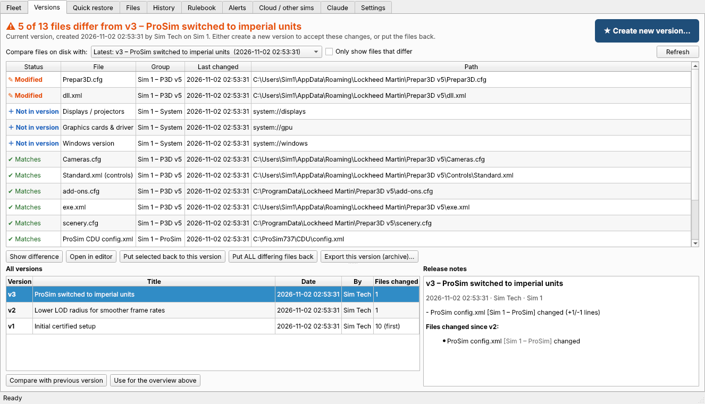

## Features

- ⭐ **Git-style history** for config files anywhere on disk — every change recorded automatically, line-by-line and per-setting diffs
- ⭐ **One-click restore** — named restore points ("Customer default", "Checkride"), restore everything or one group; always undoable
- ⭐ **Numbered versions** (v1, v2 …) of the whole configuration + overview of which files differ
- ⭐ **Certification archives** — one zip with all files, report and SHA-256 checksums; import on any PC
- ⭐ **Claude & ChatGPT** can read configs, history and other sims to troubleshoot; proposed changes need your approval
- ⭐ **Remote app** — work on any sim from another PC or a Mac over the LAN
- ⭐ **Fleet overview** of all sims, shared through **Google Drive** (direct) or any shared folder
- ⭐ **Hub web dashboard** (optional, self-hosted Node.js) — live status of every sim in a browser or on a wall
  screen: GO / NO-GO board, events, logbook, maintenance mode, uptime, Slack/Teams/Discord/ntfy alerts
- **Built-in editor** with syntax highlighting, live syntax check, find/replace; keeps encoding and line endings
- **Rulebook** — document settings and lock required values
- **Alerts** with Windows notifications and optional auto-undo; **ignore** values the sim rewrites itself
- **System info** tracked like files — GPU driver, Windows build, sim software versions, displays, hardware
- Compare and copy configs between sims · rebuild a reinstalled PC from the backup · changelog export (Notion / Sheets)
- Finds Prepar3D and ProSim config files automatically
- VS Code–style interface (dark, light or follow the system) — the same on Windows and Mac
- Tray app, starts with Windows (as administrator), installer + in-app updates


## Screenshots

| | |
|---|---|
| **Quick restore** — one button per saved setup 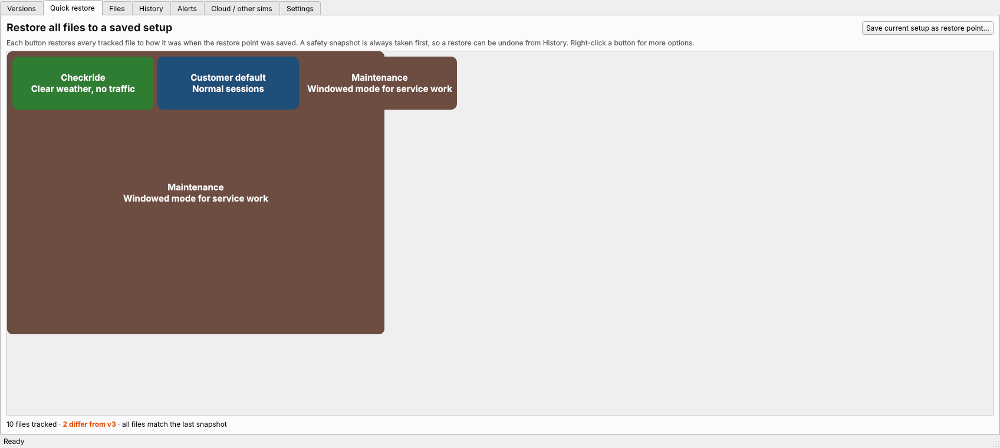 | **Files** — every tracked file with its full history 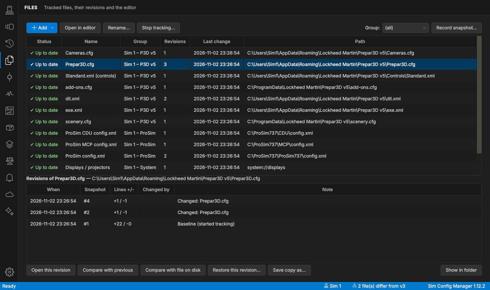 |
| **Editor** — syntax highlighting, find & replace 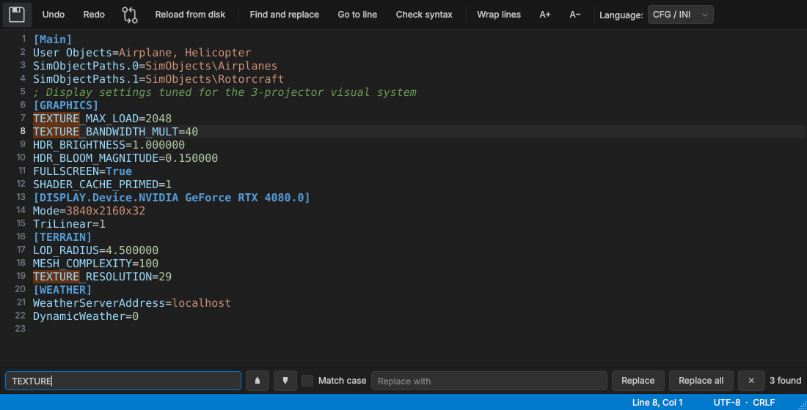 | **Live syntax check** — broken XML marked before you save 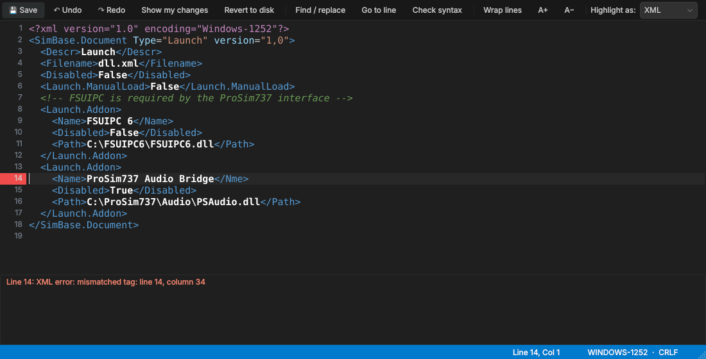 |
| **Alerts** — notifications and auto-undo for specific changes 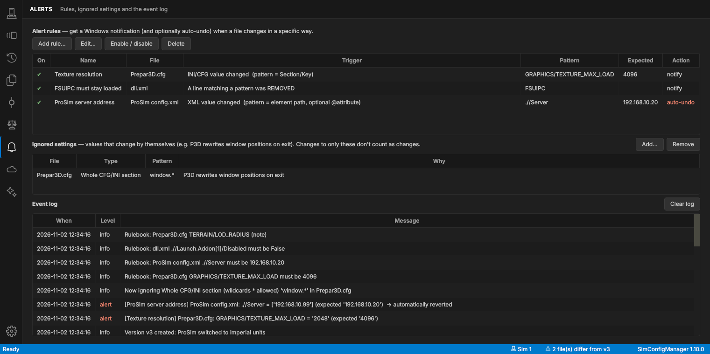 | **Create version** — release notes pre-filled with what changed 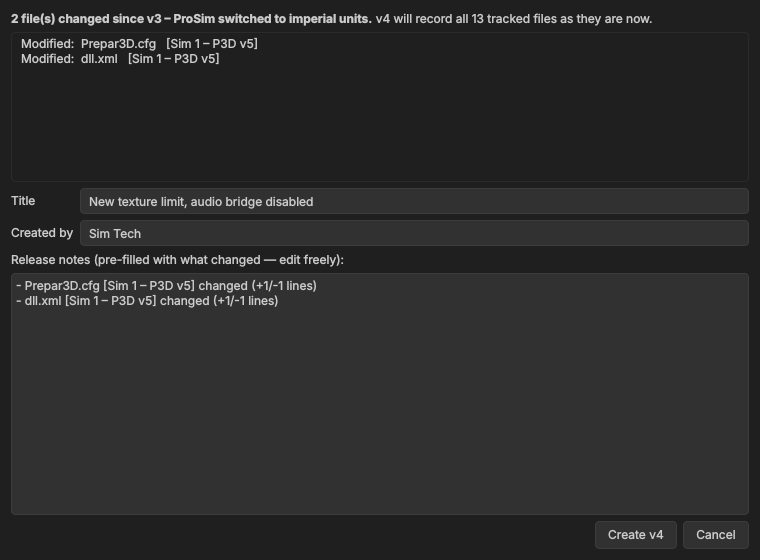 |
| **Fleet** — every sim at a glance, via Google Drive or a shared folder 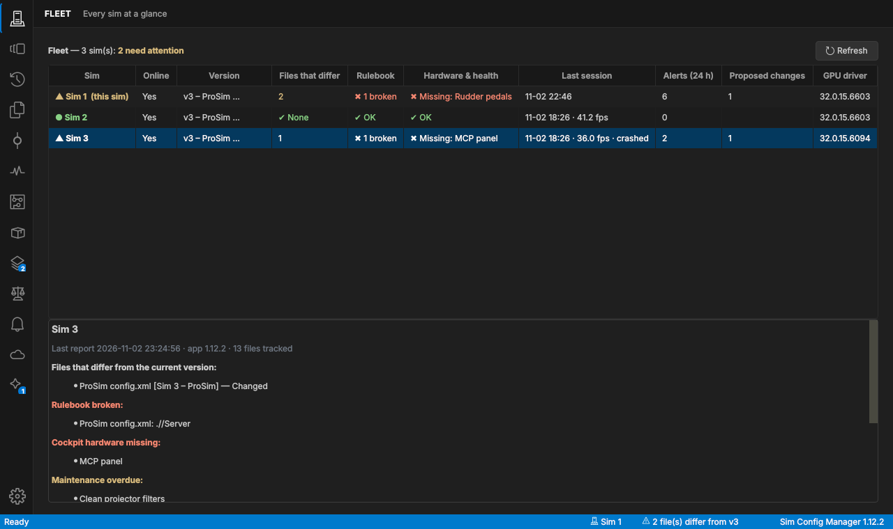 | **Rulebook** — documented and locked settings with live compliance 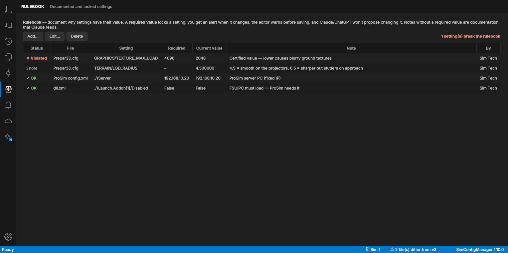 |
| **Setting-level changes** — and one click to ignore values the sim rewrites itself 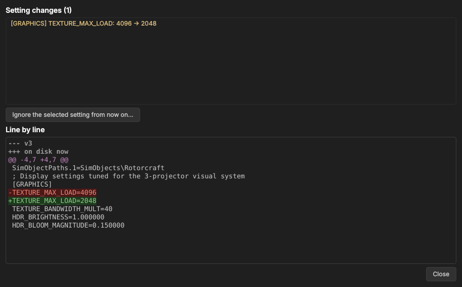 | **Google Drive, direct** — no Drive app needed on the sims 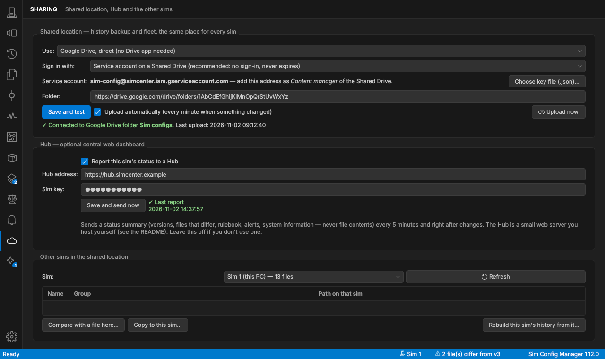 |
| **Differences** — exactly what changed, line by line 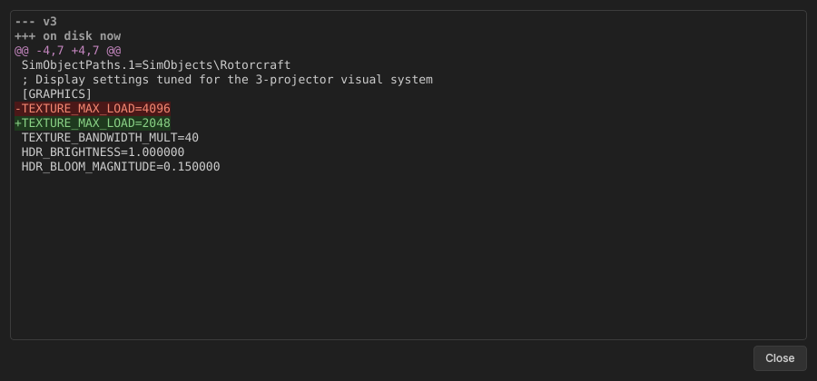 | **Claude** — reads your configs, proposes changes you approve 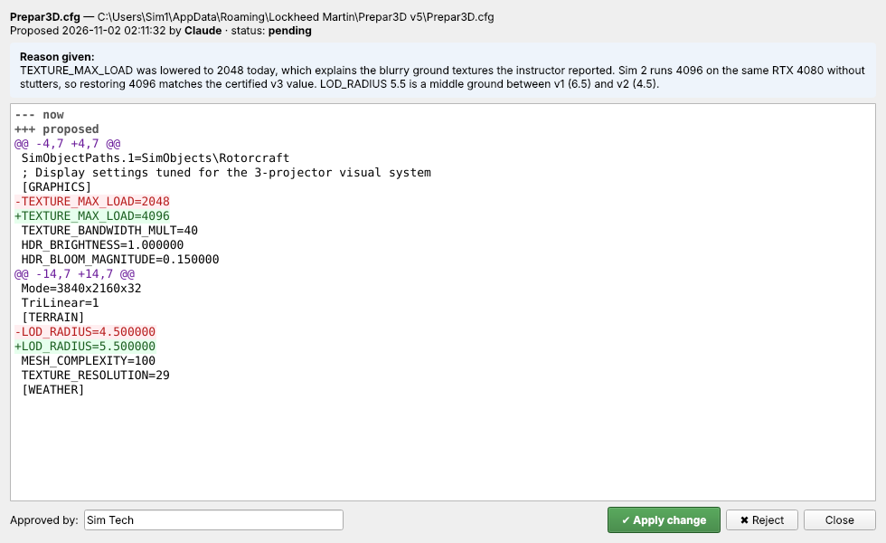 |

## Download

Get **SimConfigManager-Setup-x.y.z.exe** from the [latest release](../../releases/latest) and run it on each
sim (and on Windows laptops that should work on the sims remotely; Macs use `SimConfigManager-mac.zip`). It installs both programs (the app and the Claude/ChatGPT connector) in *Program Files*, adds a Start-menu
entry, and can be uninstalled normally (your data in `C:\ProgramData\SimConfigManager` is kept). The loose
`.exe` files are in the release too, if you prefer copying them by hand.

**Updates:** *Settings → Check for updates* (or the daily check) downloads the newest installer, verifies it
against `SHA256SUMS.txt`, installs it silently and restarts the app. No GitHub token is needed (the
repository is public); the *GitHub access token* setting is only for private forks.
Every push to `main` is also built automatically: *Actions* tab → latest run → *Artifacts*.

To publish a new release, raise `APP_VERSION` in `simconfigmanager/core.py` and push to `main` — the build
publishes `v<version>` automatically (existing releases are never overwritten).

## Install (on each sim PC)

1. Download `SimConfigManager.exe` (or build it yourself: install Python 3.10+ from python.org, tick
   "Add python.exe to PATH", then double-click **build_exe.bat** → `dist\SimConfigManager.exe`).
2. Copy the exe to e.g. `C:\SimConfigManager\` on each sim and run it.
3. Windows asks for administrator rights when it starts (needed to restore files under Program Files /
   ProgramData) — click **Yes**.
4. *Settings* tab: give the PC a name (`Sim 1`, `Sim 2`) and tick **Start with Windows as administrator**.
   This creates a Task Scheduler task ("SimConfigManager", run with highest privileges at logon), so it starts
   elevated at boot **without** a UAC prompt. (The normal Startup/Run method cannot start admin programs.)

(The exe can be built once and copied to both sims. `run_from_source.bat` runs it without building.)

## First-time setup

1. **Files → Find P3D / ProSim configs…** suggests the usual files (Prepar3D.cfg, dll.xml, exe.xml,
   add-ons.cfg, Cameras.cfg, scenery.cfg, Controls, ProSim config.xml). Type a group prefix like `Sim 1`.
   Anything else: **Add files…** (any location) or **Add folder…** (all *.xml/*.cfg in a folder).
2. Set the sim up the way it should be, then **Quick restore → Save current setup as restore point…**
   (e.g. "Customer default", "Checkride 737", "Maintenance"). Right-click a button to colour it.
3. **Cloud / other sims**: choose a folder inside Google Drive (e.g. `G:\My Drive\SimConfigManager`)
   or a share on your server (`\\SERVER\SimConfig`). Use the same folder on both sims.

## What it does

| Feature | Where |
|---|---|
| **Versions**: number the whole configuration (v1, v2, …) and see at a glance what differs | Versions |
| **Fleet overview**: all sims' status (version match, rulebook, alerts, driver, online) | Fleet |
| **Rulebook**: notes per setting, *required values* lock settings (alerts, editor warning, Claude won't change them) | Rulebook |
| **Ignored settings**: values the sim rewrites by itself don't count as changes; per-setting change summaries | Alerts, any diff window |
| **System information** tracked like files: GPU & driver, Windows build, sim software versions, displays, hardware, network, own commands | Files → Track system info |
| **Google Drive direct** (service account on a Shared Drive, or a Google account) — or any shared folder | Cloud / other sims |
| Installer, in-app updates | Settings |
| **Remote app**: run the app on another PC or a Mac and work on a sim over the LAN as if sitting at it | Claude → Network access, *connect to a sim* |
| Watches tracked files (every 5 s by default) and records a snapshot whenever one changes | automatic |
| Full history per file, with coloured line-by-line diffs | Files, History |
| Restore one file to any older version | Files → Restore this version |
| **Built-in editor** with syntax highlighting (CFG/INI, XML, JSON) | Files → Open in editor (or double-click) |
| One-click "restore everything" buttons (restore points), or only one group | Quick restore, tray menu |
| Safety snapshot before every restore, so every restore can be undone | History ("safety") |
| Warns if Prepar3D / ProSim are running before a restore (P3D rewrites Prepar3D.cfg on exit) | automatic |
| Alert rules with Windows notifications | Alerts |
| Optional **auto-undo**: lock a file to a restore point, or undo specific changes | Alerts → Action |
| Sync / off-site backup through Google Drive or a network share | Cloud / other sims |
| See the other sim's configs, compare them, copy a file across | Cloud / other sims |
| Rebuild a reinstalled PC from the backup (files, history, restore points, rules) | Cloud / other sims |
| Export changelog as Markdown (paste into Notion) or CSV (Notion database / Google Sheets) | History |
| **Certification archive**: all monitored files in one zip + REPORT.txt + checksums | Files → Export archive, tray |
| **Import archive** on this or another PC (paths translated, checksums verified) | Files → Import archive |
| **Claude connector**: Claude reads configs, history, versions and other sims; proposes changes you approve | Claude |
| **Claude from mechanics' MacBooks** over the LAN, with a personal access key per person | Claude → Network access |
| **ChatGPT** via OpenAI's Secure MCP Tunnel running on an engineer's Mac (nothing exposed to the internet) | Claude → Network access |
| Runs in the tray, starts with Windows, single instance | Settings |

### Alert rule types

* **Any change** / **deleted**
* **Line added / removed** matching a regex — e.g. removed line matching `FSUIPC` in dll.xml
* **INI/CFG value** — `GRAPHICS/TEXTURE_MAX_LOAD`, optionally "expected = 4096" → alert only if it isn't 4096
* **XML value** — ElementTree path, e.g. `.//Launch.Addon/Name`, or an attribute with `@`, e.g. `.//Server@ip`
* **No longer matches restore point** — drift alert; with "auto-undo" this *locks* the file to that setup

## Versions

At the end of a day of changes, click **★ Create new version…** (Versions tab or tray menu). The
version records **every tracked file** as it is at that moment, gets the next number (v1, v2, …), a title,
who made it, and release notes that are pre-filled with which files changed and the notes typed in the
editor. Versions are permanent — they can't be edited or deleted, so they work as a configuration record.

The **Versions** tab is the overview:

* A banner: **✔ All 23 files match v7**, or **⚠ 3 of 23 files differ from v7**
* Every file with its status: *Matches*, *Modified*, *Missing on disk*, or *Not in version* (added to
  tracking after the version was made). Tick "Only show files that differ" to filter.
* Compare with an older version via the drop-down
* **Show difference** / **Open in editor** / **Put selected back** / **Put ALL differing files back**
  (with a safety snapshot first)
* The list of all versions with their release notes, and **Compare with previous version** to see
  exactly what changed from v6 to v7
* **Export this version** creates the certification archive for that version

The tray tooltip always shows the status ("all files match v7" / "2 files differ from v7"), and you get a
notification the moment files start to differ (can be turned off in Settings). Archive reports state the
configuration version and whether the files match it. Versions are included in cloud sync and archives.

Restore points vs versions: **restore points** are named presets you switch between (e.g. "Checkride");
**versions** are the numbered, official history of the configuration.

## Hub: central web dashboard (optional)

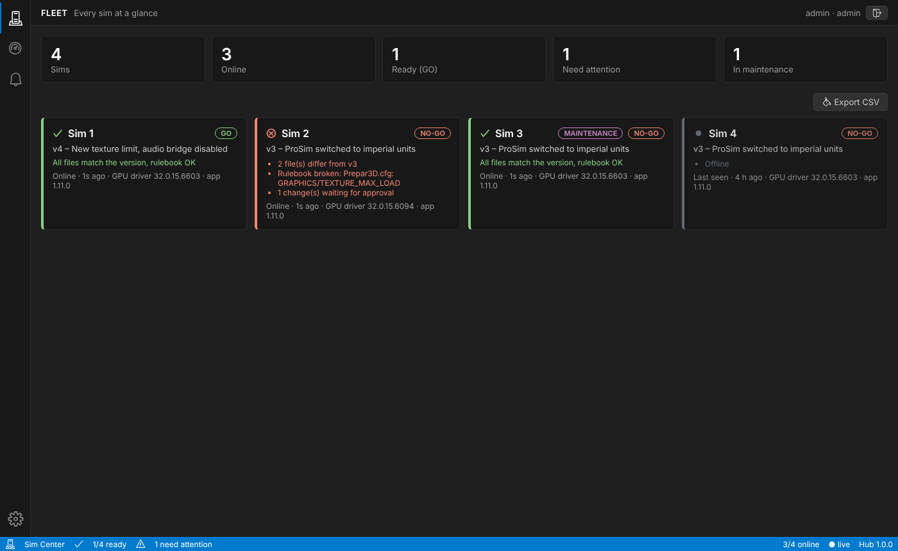

A small web server you host yourself (Node.js, no extra packages). Every sim that you connect reports its status
to it, and anyone with a login sees all sims in a browser — at the desk, on a phone, or on a TV in the workshop.
It's an add-on: the app works exactly the same without it, and it only *receives* status (never file contents,
and it can't change anything on the sims).

| | |
|---|---|
| **Sim detail** — problems, differing files, rulebook, uptime, versions, logbook 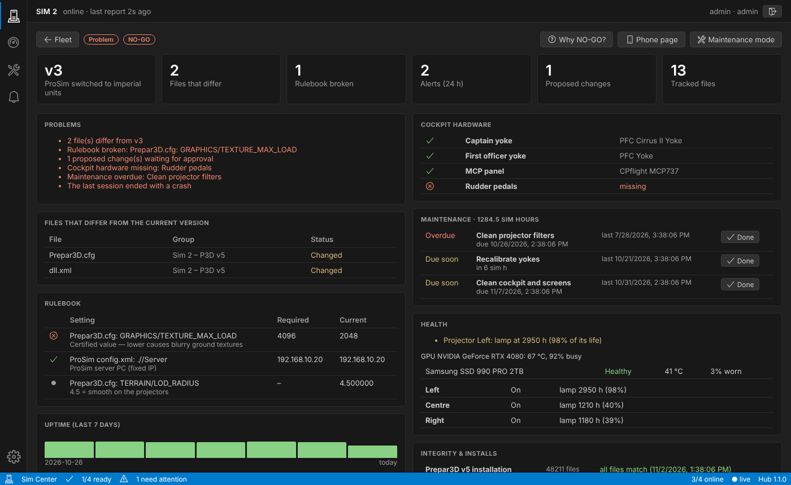 | **Readiness board** — big GO / NO-GO tiles for a wall screen 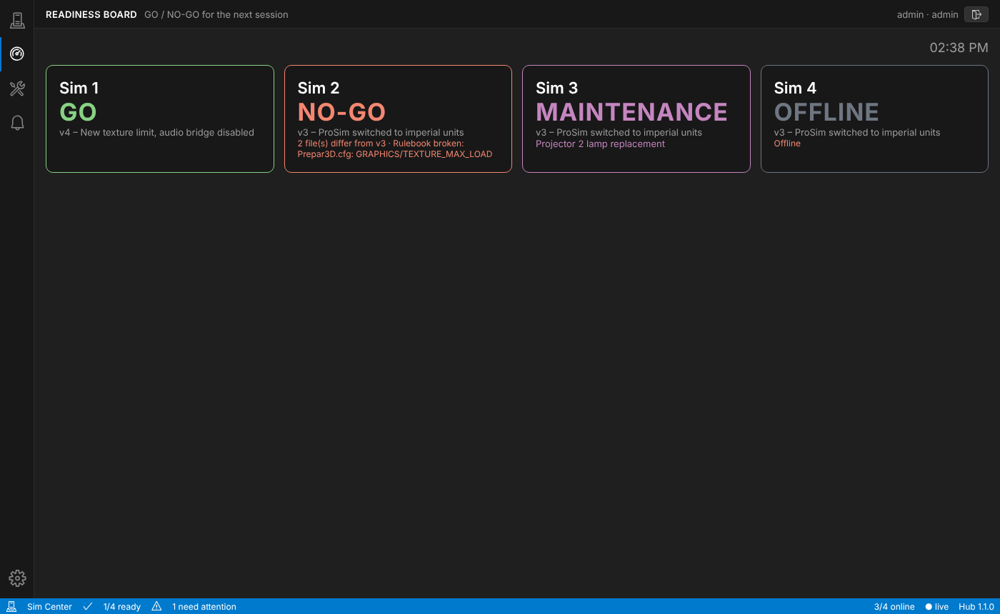 |
| **Events** — everything across the fleet, filterable 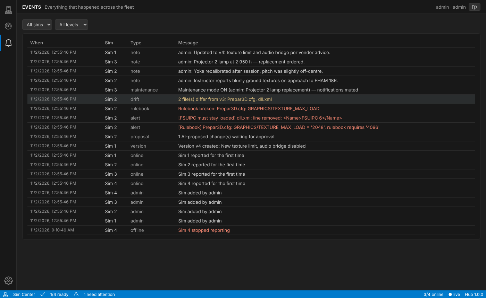 | **Phone** 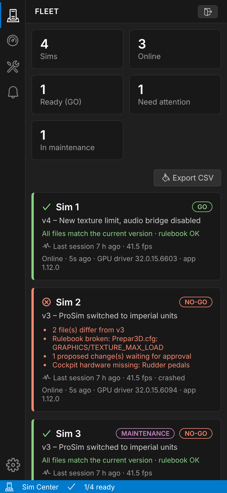 |

**What it does**
* Fleet overview: online/offline, configuration version, files that differ, rulebook problems, alerts, changes
  waiting for approval, GPU driver, app version — updating live.
* **GO / NO-GO** per sim (online, has a version, everything matches it, rulebook OK, not in maintenance) and a
  full-screen **readiness board**; a secret wall-display link signs a TV in without a password.
* **Events** for the whole fleet: sim offline/back online, files start to differ, rulebook broken/fixed, alerts
  from the sims, new versions, AI proposals waiting, maintenance, logbook entries.
* **Notifications** to Slack, Microsoft Teams, Discord, ntfy (phone push) or any JSON webhook — per event type.
* **Maintenance mode** per sim (mutes notifications, shows the reason on the board) and a **logbook** per sim
  (hardware, software, calibration, incidents).
* Uptime per sim (7 days + last 24 h), CSV export of the fleet status.
* Users with roles: *viewer* (look), *tech* (logbook, maintenance), *admin* (add sims, keys).

**Run it**

```bash
cd hub
cp config.example.json config.json      # set users/passwords, title, webhooks
node src/server.js                      # → http://localhost:8780
# or with Docker:
docker build -t scm-hub hub && docker run -d -p 8780:8780 -v scm-hub-data:/data \
  -e SCM_HUB_ADMIN_PASSWORD=change-me scm-hub
```

Needs Node.js 18.18 or newer; no `npm install`. The release also has `SimConfigManager-Hub-x.y.z.zip`. A
systemd unit is in `hub/scm-hub.service`. Settings (in `config.json` or environment variables):

| Setting | Env var | Default | |
|---|---|---|---|
| `port`, `host` | `PORT`, `HOST` | 8780, 0.0.0.0 | where it listens |
| `dataDir` | `SCM_HUB_DATA` | `./data` | sims, events, uptime (plain JSON files) |
| `title` | `SCM_HUB_TITLE` | Sim Center | shown in the page and notifications |
| `users` | `SCM_HUB_ADMIN_PASSWORD` | – | `[{name, password, role}]`; the env var creates user *admin*. Hash passwords with `node src/server.js hash-password <pw>` |
| `offlineAfterMinutes` | | 15 | no report for this long → offline |
| `kioskToken` | `SCM_HUB_KIOSK_TOKEN` | – | wall display: open `https://your-hub/kiosk?token=…` |
| `webhooks` | | – | `[{url, format: slack\|teams\|discord\|ntfy\|json, events: [...]}]` |
| `trustProxy` | `SCM_HUB_TRUST_PROXY=1` | false | behind a reverse proxy (client IP, secure cookies) |

**Connect the sims:** in the hub, *Sims & settings* (gear) → **Add sim** → copy the key. In the app on that sim:
*Cloud & other sims* → **Central dashboard** → tick *Report to a central dashboard*, paste the hub address and key →
**Save & send now**. The sim then reports every 5 minutes and right after any change.

**Security:** put the hub behind HTTPS (e.g. Caddy, nginx, Cloudflare Tunnel) if it's reachable from outside your
network; use strong passwords. Each sim has its own key (can be replaced or removed); browser sessions use
HttpOnly/SameSite cookies, logins are rate-limited.

## Remote app: work on a sim from another PC or a Mac

Run Sim Config Manager on a laptop (Windows or Mac) and work on any sim over the local network — edit files,
restore, create versions, manage the rulebook, review Claude's proposals, export certification archives (saved
on the laptop) — exactly as if you were at the sim. Everything happens on the sim itself and is logged with your
name (*"— by Jan – MacBook (remote)"*).

1. **On the sim:** *Claude* tab → *Network access* → **Add person…** → choose **Full control (remote app)**.
   Network access is switched on and a firewall rule for the local network is added. **Setup for the remote
   app…** shows the steps and a *connection file* (`.scmconnect`) — send it privately.
2. **Windows laptop:** install with the normal installer and start **Sim Config Manager - connect to a sim**
   (no admin rights needed). **Mac:** download `SimConfigManager-mac.zip` from the release, unzip, move to
   Applications, and the first time **right-click → Open** (the app isn't notarized by Apple).
3. **Add from file…** (or enter the sim's address and key) → **Connect**. Add all sims; switch any time. A sim PC
   can also open another sim: *Settings → Connect to another sim…*.

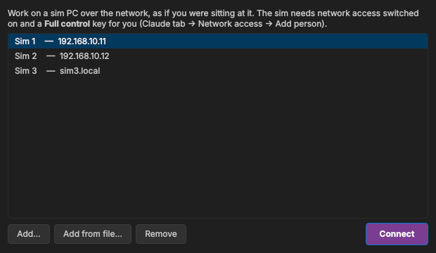

Notes: remote windows have a purple icon; the sim must be on and its app running with network access on. The
file browser shows the sim's disk; only config-type files can be read/written outside the tracked files.
Signing in to Google (account mode) has to be done at the sim itself. Access levels per person: *read only* or
*read + propose* (for Claude/ChatGPT) and *full control* (remote app). Don't expose the port to the internet.

## Google Drive (direct)

The sims can talk to Google Drive themselves — no Google Drive app on the PCs. **Cloud / other sims → Use:
Google Drive — direct**. Two ways to sign in:

**A. Service account on a Shared Drive (recommended).** No browser login, never expires — ideal for sims.
Needs Google Workspace (Shared Drives).
1. [console.cloud.google.com](https://console.cloud.google.com): create a project → *APIs & Services → Enable
   APIs* → **Google Drive API**.
2. *IAM & Admin → Service accounts* → create one (no roles needed) → *Keys → Add key → JSON* → download.
3. In Google Drive, open the Shared Drive → *Manage members* → add the service account's e-mail address
   (shown in the app) as **Content manager**. Make a folder for the sims, e.g. *Sim configs*.
4. In the app: *Sign in with: Service account* → **Choose key file** → paste the folder's link → **Save & test**.
   Do the same on every sim (same key file, same folder link).

**B. A dedicated Google account** (works with a normal Gmail account).
1. Google Cloud project with the **Google Drive API** enabled (as above).
2. *OAuth consent screen*: user type *External*, add the account as a test user, then **Publish app**
   (otherwise Google expires the sign-in after 7 days; the app only uses the non-sensitive `drive.file` scope).
3. *Credentials → Create OAuth client ID → Desktop app* → download the JSON.
4. In the app: *Sign in with: Google account* → **Choose OAuth client file** → **Sign in…**, and sign in with
   the sims' account. The app keeps its files in a *SimConfigManager* folder in that account's Drive and can
   only see files it created itself. Repeat on each sim with the same account.

What goes to Drive: each sim's history and versions (`machines/`), file versions (`objects/`), the fleet
status (`status/`, every 5 minutes) and — when ticked during export — certification archives (`archives/`).
*Files → Import archive* can import straight from there. A plain shared folder still works the same way.

## Fleet overview

The **Fleet** tab shows every sim that shares through the same Drive/folder: online, which configuration version
it runs and whether its files match, rulebook problems, alerts in the last 24 h, changes waiting for approval,
last change and graphics driver. Click a sim for details.

## Rulebook

Document *why* settings have their value (**Rulebook → Add**: pick the file and the setting — the list shows the
settings in the file — and the current value). Give a **required value** to lock it:
* an alert when it changes, the editor warns before saving, the Fleet tab flags it;
* Claude/ChatGPT read the rulebook and can't propose changing a locked value.

Entries without a required value are plain documentation that Claude takes into account.

## Ignored settings

Prepar3D rewrites some values whenever it closes (e.g. window positions). Open any difference window, select
the setting in **Setting changes** and click **Ignore the selected setting** — or add rules under **Alerts →
Ignored settings** (CFG key or section with wildcards, XML element, or regex). Changes that touch *only* ignored
settings no longer count as changes, alerts or version mismatches; the full file is still stored.

## System information

**Files → Track system info…** adds read-only "files" that are read from the PC every 15 minutes (Settings):
graphics card & driver, Windows version/build, sim software versions (Prepar3D, ProSim, FSUIPC, add-ons …),
all installed software, displays/projectors, CPU/RAM/motherboard/disks and network addresses — plus your own
PowerShell commands. They get history, versions, alerts ("driver changed"), archives and Claude access like any
file, but are never written back.

## Claude: troubleshoot and dial in settings

With the **Claude Desktop** app (claude.ai/download) on a sim PC, Claude can work directly with your
configs. Put `SimConfigManager-MCP.exe` next to `SimConfigManager.exe`, open the **Claude** tab, click
**Connect to Claude Desktop**, and restart Claude Desktop. Then just ask, e.g.:

* *"Why do we get stutters on Sim 2 but not on Sim 1?"*
* *"Compare the ProSim configs of both sims."*
* *"What changed since v3, and could that explain the blurry textures?"*
* *"Suggest Prepar3D.cfg settings for an RTX 4080 driving three projectors."*

What Claude can do through the connector:

| Read (always) | Change (only with your approval) |
|---|---|
| Overview: version status, alerts, other sims | **Propose** an edit with a reason |
| Read any tracked file — now, in any version/snapshot/restore point, or on another sim | You see the reason and the exact diff in the app (tray notification) |
| Search all files (e.g. every `TEXTURE` setting), with the cfg `[section]` | **Apply** → safety snapshot, written with the original encoding, recorded in History; or **Reject** with a note Claude can see |
| Diffs between versions, file history, release notes, recent events | Proposals that would break XML are refused up front |

The connector never writes config files itself and runs without admin rights. Turn proposals off in the
Claude tab if you want read-only. **Copy files for Claude** (Claude tab, or right-click files) copies selected
files as text you can paste into any Claude chat — handy on your phone or claude.ai.

### From a MacBook (or any laptop) on the network

Mechanics can use Claude Desktop on their own laptop and talk to a sim PC over the local network:

1. On the sim PC: **Claude** tab → **Network access** → **Add person…** (e.g. "Jan – MacBook Pro"). This
   switches network access on, adds a Windows Firewall rule that only lets in computers on the local network,
   and creates a personal access key. Choose whether that person's Claude may propose changes or only read.
2. **Setup for a Mac…** shows a ready-made Claude Desktop config. Send it to the mechanic privately
   (AirDrop / direct message).
3. On the Mac: Claude Desktop → Settings → Developer → **Edit Config**, paste, save, restart Claude Desktop.
   Nothing to install — the relay uses the Mac's built-in `bash` and `curl`.

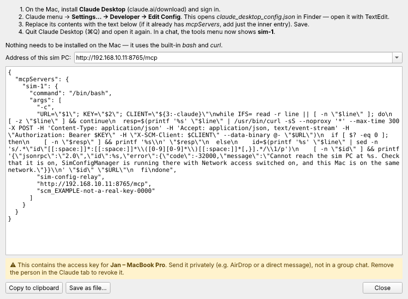

* Add one entry per sim (the config names them `sim-1`, `sim-2`, …) — or use one, since each sim can
  also read the other sims' files through the sync folder.
* Every person has their own key; **Remove access** revokes it. The Claude tab shows who connected last and
  from where, connections are logged, and proposals show who they came from ("Claude via Jan – MacBook Pro").
* Changes are still only *proposed* — they are applied on the sim PC after someone clicks Apply.
* Give the sim PCs a fixed address (DHCP reservation in the router), or use `<pc-name>.local`.
* Windows laptops: **Setup for a Windows laptop…** (uses `SimConfigManager-MCP.exe --remote <url> --key <key>`).
* The connection is plain HTTP inside your LAN with a secret key per person. Don't forward the port on the
  router / expose it to the internet.

### ChatGPT, through an engineer's Mac

ChatGPT talks to connectors from OpenAI's cloud. To keep the sims off the internet, it goes through OpenAI's
[Secure MCP Tunnel](https://developers.openai.com/api/docs/guides/secure-mcp-tunnels), run **on the
engineer's own MacBook**:

```
ChatGPT ⇄ OpenAI ⇄ tunnel-client on Jan's Mac (outbound only) ⇄ relay ⇄ LAN ⇄ SimConfigManager on Sim 1
```

* Nothing on the sim PC or your network is reachable from the internet; no router changes.
* The OpenAI login and keys live only on that Mac (runtime key in the macOS Keychain).
* ChatGPT can only reach the sim while the engineer has **Start ChatGPT access** running — close the window
  and it's cut off. The sim still checks that person's access key, and proposals show *"ChatGPT via Jan"*.

Setup: on the sim PC, **Claude** tab → Network access → select the person → **Setup for ChatGPT (via a Mac)…**.
It shows the steps and a setup script for the Mac:

1. **OpenAI (once):** platform.openai.com → Settings → Organization → **Tunnels**: create a tunnel linked to your
   ChatGPT workspace; create a runtime API key with Tunnels *Read + Use*.
2. **Mac (once):** AirDrop the script, run `bash ~/Downloads/setup-chatgpt-sim-1.command`, paste the tunnel ID and
   key. It installs OpenAI's `tunnel-client` with Homebrew and creates *Start ChatGPT access – Sim 1*.
3. **ChatGPT (once):** Settings → Apps & Connectors (Developer mode if needed) → **Add custom MCP server** →
   Connection: **Tunnel**.

Availability of custom connectors and tunnels depends on your ChatGPT plan and workspace settings.

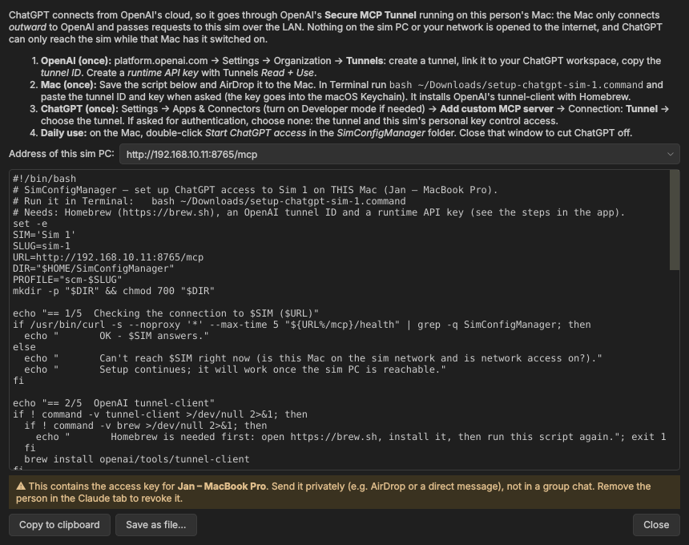

The connector is a standard MCP server (stdio), so other MCP clients work too:
`SimConfigManager-MCP.exe [--data <data folder>]`.

## Editor

Double-click a file (or **Files → ✎ Open in editor**). Features:

* Syntax highlighting for P3D/ProSim CFG/INI, XML and JSON (switchable), line numbers
* Find / replace (Ctrl+F, Ctrl+H, F3), go to line (Ctrl+G), undo/redo, zoom, line wrap
* Live syntax check: broken XML, duplicate CFG keys, malformed lines are marked red in the margin
* **Save (Ctrl+S)** shows exactly what will change, asks for a short note, warns if the sim is running,
  and records the edit in History (with a safety copy first) — so every edit can be undone
* Keeps the file's original encoding (e.g. Windows-1252 in dll.xml, UTF-8 BOM) and Windows line endings
* Notices when the sim changes the file while you edit, and lets you compare / reload / keep your edits
* **View this version** in the file history opens an old version read-only, with a one-click restore

## Certification archive

**Files → Export archive (zip)…** creates e.g. `Sim_1_configs_2026-11-01_1650.zip` plus
`Sim_1_configs_2026-11-01_1650.zip.sha256`. Keep both together. The zip contains:

* `files/<group>/…` — readable copies of every monitored file
* `REPORT.txt` — PC name, date, who exported it, OS, your note, and for every file: path, size,
  last-modified date and SHA-256 checksum, plus the restore points and a signature line
* `CHECKSUMS.sha256` — standard checksum list (`sha256sum -c` compatible)
* `archive.json` — machine-readable index used for importing
* `history/` — (optional) the full version history, restore points and alert rules

The `.sha256` file next to the zip proves the zip has not been altered since export; the import screen
checks it automatically. You can also check it on any Windows PC with
`certutil -hashfile <zip> SHA256`.

**Files → Import archive…** shows every file, verifies its checksum, and suggests where it goes on this PC
(paths in the user profile, AppData and ProgramData are translated automatically — double-click a target to
change it). Options: write the files, keep monitoring them, and — on a fresh install — bring in the full
history, restore points and rules. A safety snapshot is taken first.

Restore points can also be exported this way (right-click a restore point → Export).

## Code signing (optional)

Windows shows "unknown publisher" for unsigned programs. To remove that, the build can sign the installer and
programs. The most affordable route is Microsoft's Azure Trusted Signing service (monthly fee, needs a
registered business and a short identity check); a classic code-signing certificate also works. Once you have
an account, signing can be added to the GitHub build.

## Development

```
pip install -r requirements.txt pytest
python -m pytest tests                                   # engine tests
python SimConfigManager.pyw --no-elevate --data .\testdata  # run with a throw-away data folder
```

`simconfigmanager/core.py` — storage, snapshots, versions, rules, sync, archives ·
`gui.py` — main window · `editor.py` — built-in editor · `mcp_server.py` — Claude connector ·
`net.py` — network access (HTTP endpoint, relays, access keys) · `remote.py` — remote app ·
`storage.py` — folder / Google Drive backends · `updater.py` — updates · `hub/` — the optional web dashboard
(`cd hub && npm test`). Hub screenshots: `python tools/hub_screenshots.py`.
Regenerate the README screenshots with `QT_QPA_PLATFORM=offscreen python tools/make_screenshots.py`.

## Notes

* Data lives in `C:\ProgramData\SimConfigManager` (SQLite + compressed copies of every version). Installs
  from before the rename (*SimConfigKeeper*, ≤ 1.3) keep using their existing data folder automatically.
  Nothing is ever deleted from history.
* Sync never conflicts: each PC writes only its own `machines\<name>.json`; file versions are stored
  by content hash. Changing a PC's name starts a new manifest (the old one stays as a backup).
* Rename `Sim 1` / `Sim 2` in Settings *before* setting up sync.

## Credits

* Icons: [Codicons](https://github.com/microsoft/vscode-codicons) by Microsoft, licensed under
  [CC BY 4.0](https://creativecommons.org/licenses/by/4.0/) (bundled unmodified in `simconfigmanager/assets`).
* The look is inspired by Visual Studio Code's Dark Modern / Light Modern themes. This project is not affiliated
  with Visual Studio Code or Microsoft.
* Built with [Qt for Python (PySide6)](https://doc.qt.io/qtforpython/).

## Disclaimer

**Made entirely with AI.** All code, tests, build scripts, documentation and screenshots in this repository were
generated by an AI system (Anthropic's Claude). The repository owner did not write or contribute to the code and
has not reviewed it line by line. It may contain bugs, security issues or behaviour that doesn't match this
README.

**No support.** No support, maintenance, bug fixes or updates are promised. Issues and pull requests may go
unanswered. Use it only if you are able to judge and fix it yourself.

**No warranty, use at your own risk.** The software is provided "as is", without warranty of any kind, express
or implied, including fitness for a particular purpose. The owner is not liable for any damage or loss — including
lost or corrupted configuration files, simulator downtime, missed training sessions or failed audits — arising
from its use. Keep independent backups of your configuration files, especially before restoring, importing or
applying changes.

**Not an approved tool for flight training or certification.** This app is not certified, qualified or approved
by any aviation authority (EASA, FAA or others) or certification body. Archives, reports, checksums and version
records it produces are aids for your own record-keeping; whether they are acceptable evidence is for your
organisation and auditor to decide. It does not replace your own configuration-control procedures.

**AI assistants can be wrong.** Answers and change proposals from Claude, ChatGPT or other AI tools connected to
this app may be incorrect. Review every proposed change before approving it. Configuration file contents are sent
to the AI provider you connect (Anthropic, OpenAI) and are subject to their terms and privacy policies.

**Security.** The network features (Claude/ChatGPT access, remote app) are meant for a trusted local network
only. Traffic is plain HTTP protected by access keys, not encrypted. Don't expose the port to the internet, share
keys only privately, and remove access for people who no longer need it. The app runs with administrator rights
on the sim PCs.

**Third-party services and data.** Google Drive, GitHub, Anthropic and OpenAI features depend on those services,
their terms and your accounts with them. You are responsible for the credentials and data you put into the app
(service-account keys, tokens, access keys).

**Trademarks.** Not affiliated with, endorsed by or sponsored by Lockheed Martin (Prepar3D), ProSim-AR (ProSim),
Pete & John Dowson (FSUIPC), Microsoft, Google, Apple, Anthropic or OpenAI. All product names and trademarks
belong to their respective owners and are used only to describe compatibility.

